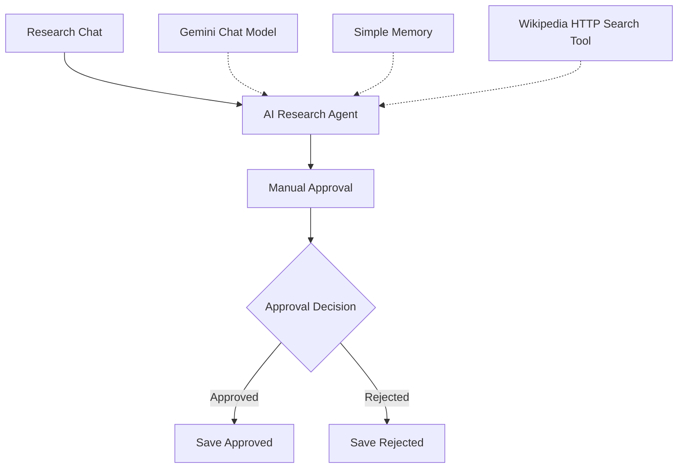

# Research Assistant - manual approval

n8n workflow that:
- accepts a research request in chat
- uses an AI agent with Gemini, memory, and Wikipedia search via HTTP
- proposes a follow-up action
- requires manual approval
- saves approved or rejected outcomes to a Data Table

## Flow

`Chat → AI Research Agent → Manual Approval → Approval Decision → Save Approved / Save Rejected`

## Tested cases

- **Approved:** approved follow-up is saved with `status = approved`
- **Rejected:** rejected follow-up is saved with `status = rejected`
- **No reliable information:** the agent states that the available source is insufficient instead of inventing facts, then proposes a verification follow-up

